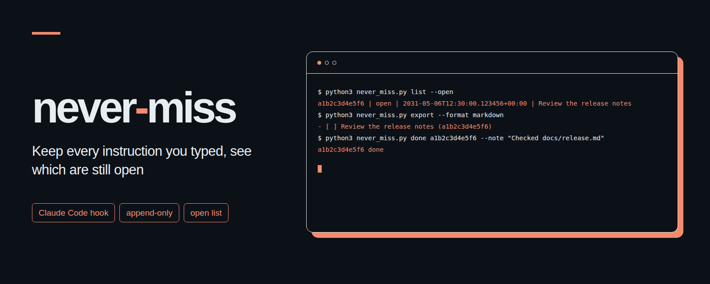

# never-miss
<p align="center"></p>

Claude Code에 입력한 지시를 로컬 파일에 원문 그대로 모아 두고, 아직 처리하지 않은 지시를 보여 주는 작은 훅 도구입니다.

[English](README.md)

## 만든 이유

세션을 여러 개 띄워 놓고 작업하다 보면 직접 입력한 지시가 다른 세션의 전달문, 작업 알림, 예약 실행 문구 사이에 묻히기 쉽습니다. never-miss는 받아들인 입력을 한 줄짜리 JSONL 기록으로 남깁니다. 입력 안의 줄바꿈도 그대로 보존하고, 완료 표시는 별도 파일에 기록해 원본을 수정하지 않습니다.

알려진 자동 생성 문구의 머리말은 걸러냅니다. 지시 내용을 스스로 해석하거나 작업을 자동으로 만들지는 않습니다. 공식 훅 입력에는 사람이 직접 입력했는지 확정할 수 있는 표시가 없습니다. 따라서 머리말이 없는 자동 메시지는 기록될 수 있고, 사람이 입력했더라도 제외 머리말로 시작하면 빠질 수 있습니다. 사용하는 예약 도구와 전달 도구에 맞는 머리말을 추가하고, 열린 목록을 확인한 뒤 작업에 쓰세요.

macOS 또는 Linux에서 Python 3.9 이상이 필요합니다. 파일 잠금용 `fcntl`을 포함해 파이썬 표준 라이브러리만 사용합니다. 별도 계정이나 서버, 네트워크 연결은 필요하지 않습니다.

## 설치 3단계

1. 이 폴더를 내려받아 터미널에서 열고, 스크립트 파일 하나를 계속 둘 위치로 복사합니다.

   ```sh
   python3 --version
   mkdir -p ~/.local/bin
   cp never_miss.py ~/.local/bin/never_miss.py
   ```

2. 훅 설정 예시를 출력합니다.

   ```sh
   python3 ~/.local/bin/never_miss.py install
   ```

   출력된 `UserPromptSubmit` 항목을 `~/.claude/settings.json`에 합칩니다. 기존 설정과 다른 훅은 그대로 유지하세요. 특정 프로젝트에만 적용하려면 `install --project`를 실행해 나온 내용을 그 프로젝트의 `.claude/settings.json`에 합칩니다. 이 명령은 안내만 출력하며 설정 파일을 직접 고치지 않습니다. [examples/settings.json](examples/settings.json)은 위 복사 위치에 맞춘 최소 설정 예시입니다. 훅이 두 번 실행되지 않도록 한 범위에만 등록하세요.

3. 새 Claude Code 세션을 시작해 평소처럼 지시를 입력한 뒤 기록을 확인합니다.

   ```sh
   python3 ~/.local/bin/never_miss.py list --open
   ```

   목록이 비어 있다면 훅이 실행되지 않았거나, 필터에서 걸러졌거나, 파일 쓰기에 실패했을 수 있습니다. 설정 파일과 상태 폴더의 `errors.jsonl`을 확인하세요. 훅 자체는 화면에 아무것도 출력하지 않습니다. 사용을 중단하려면 설정에서 이 훅 항목만 빼면 되며, 저장된 기록은 따로 보관하거나 지울 수 있습니다.

## 명령

이 폴더에서는 `python3 never_miss.py <명령>`으로 실행하고, 다른 폴더에서는 설치한 스크립트 경로를 지정해 실행합니다.

| 명령 | 하는 일 |
| --- | --- |
| `hook` | 표준 입력에서 훅 JSON 하나를 읽습니다. 화면 출력 없이 항상 종료 코드 0으로 끝납니다. |
| `list [--since 2h] [--open] [--json]` | 저장된 기록을 봅니다. `--open`은 처리하지 않은 항목만, `--json`은 원본 기록의 JSON 배열을 출력합니다. |
| `done <key> [--note "내용"]` | 완료 기록을 덧붙입니다. 같은 키를 다시 처리해도 중복 기록되지 않습니다. 목록에 나온 키 전체를 쓰세요. |
| `export --format markdown` | 열린 지시를 마크다운 체크리스트로 출력합니다. |
| `export --format agent-cards --agent helper --due YYYY-MM-DD` | 셸 인용 처리가 된 [agent-cards](https://github.com/kks0488/agent-cards)의 `add` 명령 줄을 출력합니다. 담당과 기한 옵션을 모두 지정해야 합니다. |
| `install [--project]` | 현재 파일 위치에 맞는 훅 설정 예시를 출력합니다. 설정 파일을 직접 고치지 않습니다. |

`--since`는 정수 뒤에 초, 분, 시간, 일, 주를 뜻하는 `s`, `m`, `h`, `d`, `w`를 붙여 지정합니다. 목록은 기록된 순서대로 나옵니다. 결과물이 없을 때 일반 출력은 아무것도 찍지 않고, JSON 출력은 `[]`를 내보냅니다. 훅 이외의 명령은 상태 파일 오류 시 종료 코드 1, 잘못된 인수 입력 시 2를 반환합니다.

내보내기는 화면에 텍스트만 출력합니다. 명령을 대신 실행하거나, 완료 표시를 남기거나, agent-cards와 연결하지 않습니다. 출력된 내용을 검토하고 agent-cards를 설정한 뒤 그 도구의 폴더에서 실행하세요. 담당과 기한은 직접 지정해야 합니다. 같은 내용을 다시 내보내 실행하면 같은 명령이 반복되며, agent-cards는 중복을 걸러 주지 않습니다. 내보낸 제목은 공백과 줄바꿈을 한 줄로 합치지만, 보관함의 원본 기록은 그대로 유지합니다. 카드 설명에는 `never-miss:<key>`가 들어갑니다.

## 설정

모든 상태 파일은 `NEVER_MISS_DIR` 아래에 저장하며, 기본 위치는 `~/.local/state/never-miss`입니다.

| 파일 | 내용 |
| --- | --- |
| `inbox.jsonl` | 받아들인 지시 원본입니다. 한 줄에 JSON 객체 하나씩 기록됩니다. |
| `done.jsonl` | 처리한 키, 시각, 선택 입력한 메모입니다. |
| `errors.jsonl` | 훅 실패 기록입니다. 지시 목록과 분리해 보관합니다. |
| `config.json` | 필요할 때만 만드는 필터 설정 파일입니다. |
| `.lock` | 읽기와 쓰기 순서를 맞추는 잠금 파일입니다. |

필요하면 `config.json`을 다음처럼 만듭니다.

```json
{
  "sessions": [],
  "cwds": [],
  "skip_prefixes": ["[daily check]", "Timer tick:"]
}
```

| 환경 변수 | 뜻 |
| --- | --- |
| `NEVER_MISS_DIR` | 상태 파일을 둘 폴더입니다. `~` 확장을 지원합니다. |
| `NEVER_MISS_SESSIONS` | 허용할 세션 ID 목록입니다. 정확히 일치해야 하며, 비워 두면 모든 세션을 받습니다. `sessions`보다 우선합니다. |
| `NEVER_MISS_CWDS` | 허용할 작업 폴더 목록입니다. 심볼릭 링크를 푼 실제 경로를 기준으로 해당 폴더와 하위 폴더를 모두 받습니다. 비워 두면 모두 받으며 `cwds`보다 우선합니다. |
| `NEVER_MISS_SKIP_PREFIXES` | 건너뛸 머리말을 추가합니다. 기본 목록 및 `config.json`의 목록과 함께 적용됩니다. |

목록 형태인 변수는 문자열을 담은 JSON 배열이나 줄바꿈으로 구분한 값으로 지정합니다.

```sh
export NEVER_MISS_SESSIONS='["session-alpha", "session-beta"]'
export NEVER_MISS_CWDS='["~/work/sample"]'
export NEVER_MISS_SKIP_PREFIXES='["[daily check]", "Timer tick:"]'
```

환경 변수는 Claude Code를 시작하는 환경에 지정해야 하며, 나중에 조회 명령을 실행할 때도 같은 `NEVER_MISS_DIR`를 써야 합니다. 세션 목록과 폴더 목록을 모두 지정하면 두 조건이 모두 맞아야 기록합니다. 머리말 검사는 앞쪽 공백과 영문 대소문자를 무시하고 입력의 시작 부분만 확인합니다. 일반 문장 중간에 알림 문구가 들어가도 그 문장을 건너뛰지 않습니다.

기본 제외 목록은 스크립트 앞부분의 `DEFAULT_SKIP_PREFIXES`에 정의되어 있습니다. 세션 간 전달문, 작업 알림, 시스템 리마인더, 팀원 에이전트 메시지, 그리고 예약 실행이나 크론 및 루프에서 흔히 쓰는 머리말을 포함합니다. 구별할 머리말이 없는 임의의 자동 입력은 가려낼 수 없습니다. 그 외 비어 있지 않은 입력은 원문 그대로 남깁니다. 한 번의 입력에 여러 지시가 들어 있어도 기록은 하나로 남습니다.

## 기록과 실패 처리

원본 기록 한 줄에는 `id`, `t`, `said`, `session`, `cwd`, `key` 여섯 항목만 들어갑니다. `t`는 마이크로초까지 기록한 UTC 시각이고, `said`는 수정하지 않은 입력 원문입니다. `session`은 훅 입력의 `session_id`입니다. `key`는 UTF-8로 인코딩한 `t + "|" + said`의 SHA-1 해시 앞 12자리입니다.

공식 문서의 선택 항목인 `prompt_id`가 들어오면 세션과 입력 ID를 조합해 `id`를 만듭니다. 같은 입력이 다시 전달되어도 재시작 여부와 관계없이 중복 기록하지 않으며, 입력 ID가 다르면 같은 문장을 다시 입력해도 따로 보존합니다. `prompt_id`가 없을 때는 같은 세션과 폴더에서 2초 안에 들어온 동일한 문장만 즉시 재시도로 간주합니다. 이 2초 안의 의도적인 반복 입력도 하나로 합쳐지며, 그 이후의 반복은 따로 기록합니다. 이미 있는 키는 두 번 쓰지 않습니다.

중복 확인과 파일 쓰기는 하나의 배타적 `fcntl` 잠금 안에서 처리하고, 내용을 디스크에 반영한 뒤에 잠금을 풉니다. 읽기 작업도 공유 잠금으로 두 기록 파일을 함께 확인합니다. 잠금 대기로 인해 입력이 멈추지 않도록 잠금 획득 시간은 1초로 제한합니다. 깨진 입력, 잘못된 설정, 저장 실패가 발생해도 훅은 아무 출력 없이 종료 코드 0으로 끝납니다. 오류는 별도 파일에 기록을 시도하지만, 상태 폴더 자체에 접근할 수 없으면 오류도 남길 수 없습니다. 저장에 실패한 지시를 모아 두었다가 나중에 다시 보내는 기능은 없습니다. 기존 기록 파일이 깨져 있으면 파일을 건드리지 않고 오류로 알립니다.

새로 만드는 상태 폴더의 권한은 `0700`, 새 기록 파일과 잠금 파일은 `0600`이며, 이미 있던 파일과 폴더의 권한은 바꾸지 않습니다. 입력 원문에서 비밀값을 자동으로 가리지 않으므로 무엇을 입력할지와 상태 폴더를 어디에 둘지 정할 때 참고하세요. 이 도구는 어떤 내용도 외부로 전송하지 않습니다.

## 터미널 출력 예

다음은 설명을 위한 가상의 출력이며, 키와 시각은 예시입니다.

```text
$ python3 never_miss.py list --open
a1b2c3d4e5f6 | open | 2031-05-06T12:30:00.123456+00:00 | 배포 안내 검토
$ python3 never_miss.py export --format markdown
- [ ] 배포 안내 검토 (a1b2c3d4e5f6)
$ python3 never_miss.py export --format agent-cards --agent helper --due 2031-05-10
python3 agent_cards.py add --due 2031-05-10 --note never-miss:a1b2c3d4e5f6 -- helper '배포 안내 검토'
$ python3 never_miss.py done a1b2c3d4e5f6 --note "docs/release.md 확인"
a1b2c3d4e5f6 done
$ python3 never_miss.py list --open --json
[]
```

## 공식 문서

**2026-11-02**에 Anthropic의 [Claude Code 훅 공식 문서](https://code.claude.com/docs/en/hooks)에서 [공통 입력 항목](https://code.claude.com/docs/en/hooks#common-input-fields), [UserPromptSubmit](https://code.claude.com/docs/en/hooks#userpromptsubmit), [설정 형식](https://code.claude.com/docs/en/hooks#configuration), [종료 코드](https://code.claude.com/docs/en/hooks#exit-code-output) 항목을 확인했습니다.

이 도구는 `prompt`, `session_id`, `cwd`, `hook_event_name`과 선택 항목인 `prompt_id`를 읽으며, 대화 기록 파일은 읽지 않습니다. 공식 원문은 "UserPromptSubmit hooks don't fire only on prompts you type."라고 설명하며, 예약 작업, 백그라운드 서브에이전트의 결과 보고, 다른 세션의 전달문에서도 훅이 호출된다고 명시합니다. 머리말 필터가 필요한 이유이자, 필터만으로는 사람의 입력임을 확정할 수 없는 이유입니다. 이 이벤트는 설정의 `matcher`를 지원하지 않아 스크립트 안에서 직접 걸러냅니다. 설정 예시는 표준 입력으로 JSON을 받는 명령 훅이며, `matcher` 없이 제한 시간을 3초로 둡니다. 출력 없이 종료 코드 0으로 끝나면 원래 입력은 그대로 진행됩니다.

## 테스트

이 폴더에서 다음 명령으로 실행합니다.

```sh
python3 -m unittest -v
```

임시 상태 폴더와 실제 CLI 하위 프로세스를 실행해 필터, 원문 보존, 중복 처리, 여러 프로세스의 동시 쓰기, 잠금 경합, 조용한 실패 처리, 완료 표시, 내보내기, 설치 설정 출력을 검증합니다. 실제 Claude Code 설정을 고치거나 실제 세션을 호출하지는 않습니다.

## 라이선스

[MIT](LICENSE). Copyright (c) 2026 kks0488.
