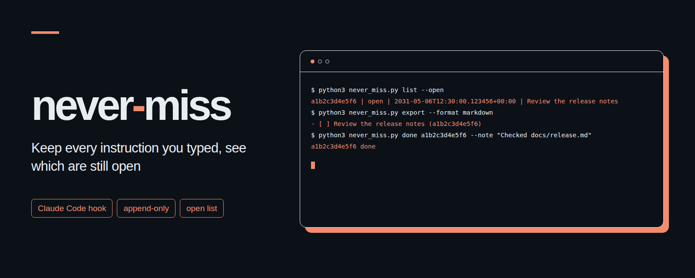

# never-miss
<p align="center"></p>

A small Claude Code hook that saves submitted instructions in a local append-only inbox and shows which ones are still open.

[한국어](README.ko.md)

## Why

When several sessions run at once, instructions can get buried under messages from other sessions, task updates, and scheduled checks. never-miss saves each accepted prompt as one JSONL record, preserving its exact text and line breaks by default. Completion records go into a separate file so the original stays intact.

The hook excludes known automation prefixes. It does not interpret instructions. Optional delivery runs only when you explicitly call `dispatch`. Because the documented hook input has no reliable human-origin flag, unmarked automated text can still be captured, and a human prompt beginning with an excluded prefix will be skipped. Add prefixes for your own schedulers and message relays, and check the open list before acting on it.

Requires Python 3.9 or later on macOS or Linux. It uses only the Python standard library, including `fcntl` for file locking. Local capture needs no account, service, or network access.

## Install in three steps

1. Download this directory, open a terminal in it, and copy the single script to a stable location:

   ```sh
   python3 --version
   mkdir -p ~/.local/bin
   cp never_miss.py ~/.local/bin/never_miss.py
   ```

2. Print the hook settings:

   ```sh
   python3 ~/.local/bin/never_miss.py install
   ```

   Merge the printed `UserPromptSubmit` entry into `~/.claude/settings.json`, keeping your other settings and hooks. For a single project, run `install --project` and merge the output into that project's `.claude/settings.json`. The command only prints instructions and does not edit files. [examples/settings.json](examples/settings.json) is a complete minimal example for the location used above. Configure the hook in one scope only so it does not run twice.

3. Start a new Claude Code session, submit an ordinary instruction, and check the inbox:

   ```sh
   python3 ~/.local/bin/never_miss.py list --open
   ```

   An empty inbox can mean the hook did not run, a filter excluded the prompt, or a write failed. Check your settings and `errors.jsonl` in the state directory. The hook deliberately prints nothing. To uninstall, remove only this hook entry from your settings; you can keep or remove the saved inbox separately.

## Commands

Run these as `python3 never_miss.py <command>`, using your installed script path when running outside this directory.

| Command | Purpose |
| --- | --- |
| `hook` | Read one Claude Code hook JSON object from standard input. Always return exit code 0 without stdout or stderr. |
| `list [--since 2h] [--open] [--json]` | Show saved instructions. `--open` excludes completed keys. `--json` prints a JSON array of the original records. |
| `done <key> [--note "text"]` | Append a completion record. Repeating it for the same key has no effect. Use the full key shown by `list`. |
| `export --format markdown` | Print open instructions as a Markdown checklist. |
| `export --format agent-cards --agent helper --due YYYY-MM-DD` | Print shell-quoted [agent-cards](https://github.com/kks0488/agent-cards) `add` commands. Both additional options are required. |
| `collect --source laptop` | Merge JSONL records from standard input with a stable origin label. Replays are ignored. |
| `dispatch` | Send pending records using the configured command, saving acknowledgements separately. |
| `install [--project]` | Print a settings snippet for the current script location. Never edit a settings file. |

`--since` accepts an integer followed by `s`, `m`, `h`, `d`, or `w`. Records remain in capture order. An empty list prints nothing in text mode and `[]` in JSON mode. Non-hook commands return 1 for state errors and 2 for invalid arguments.

The two `export` formats only print text. They do not execute commands, mark anything done, or contact agent-cards. Run exported commands from the agent-cards directory after reviewing them and configuring that tool. The assignee and deadline must be chosen explicitly. Repeating an export repeats the same commands, and agent-cards does not deduplicate them. Exported titles flatten whitespace into one line, while the inbox retains the original text. The note includes the source key as `never-miss:<key>`.

## Configuration

All state lives under `NEVER_MISS_DIR`, defaulting to `~/.local/state/never-miss`:

| File | Contents |
| --- | --- |
| `inbox.jsonl` | Original accepted prompts, one JSON object per line. |
| `done.jsonl` | Completion keys, timestamps, and optional notes. |
| `errors.jsonl` | Hook failures, kept separate from instructions. |
| `config.json` | Optional filters and integrations shown below. |
| `outbox.jsonl` | Durable delivery entries, reconciled from the inbox by `dispatch`. |
| `deliveries.jsonl` | Append-only delivery attempts and successful acknowledgements. |
| `.dispatch.lock` | Serializes delivery without blocking prompt capture. |
| `.lock` | Shared coordination file for readers and writers. |

Optional `config.json`:

```json
{
  "sessions": [],
  "cwds": [],
  "skip_prefixes": ["[daily check]", "Timer tick:"]
}
```

| Environment variable | Meaning |
| --- | --- |
| `NEVER_MISS_DIR` | State directory, with `~` expansion. |
| `NEVER_MISS_SESSIONS` | Exact session ID allowlist. Empty accepts every session. Overrides `sessions`. |
| `NEVER_MISS_CWDS` | Working directory allowlist. Each entry includes that directory and its descendants after resolving symbolic links. Empty accepts every directory. Overrides `cwds`. |
| `NEVER_MISS_SKIP_PREFIXES` | Extra excluded prefixes, added to those in `config.json` and the built-in list. |

List variables accept a JSON array of strings or one value per line. For example:

```sh
export NEVER_MISS_SESSIONS='["session-alpha", "session-beta"]'
export NEVER_MISS_CWDS='["~/work/sample"]'
export NEVER_MISS_SKIP_PREFIXES='["[daily check]", "Timer tick:"]'
```

Set these variables in the environment that launches Claude Code, and use the same `NEVER_MISS_DIR` for later CLI commands. When both session and directory lists are nonempty, both must match. Prefix checks ignore leading whitespace and letter case, and check only the beginning of the prompt. Mentioning a notification marker later in ordinary text does not exclude the prompt.

The built-in prefixes are defined in `DEFAULT_SKIP_PREFIXES` near the start of the script. They cover cross-session messages, task notifications, system reminders, teammate messages, and common scheduled, cron, and loop headers. They cannot recognize arbitrary automation without a distinguishing header. All other nonempty prompt text is kept unchanged unless optional redaction or channel extraction is enabled. Each prompt is saved as one record, even if it contains several instructions.

## Optional redaction, collection, and delivery

Just drop the options you actually need into `config.json`:

```json
{
  "redact_secrets": true,
  "source": "laptop",
  "sessions": ["watch-session"],
  "session_ledger": "~/session-ledger.json",
  "session_names": ["primary"],
  "channel_sessions": ["watch-session"],
  "export_command": ["python3", "receiver.py"],
  "export_timeout": 10
}
```

Before anything is saved, redaction swaps out likely identity numbers, Luhn-valid card numbers, common access keys, labelled passwords, and password-like strings near login hints with `[REDACTED]`, leaving the rest of the whitespace alone. Since this relies on heuristics, it can still miss secrets or accidentally mask normal text, and it only checks prompt text. Once values are redacted, they can't be recovered, and existing records are never redacted retroactively, even right before delivery.

Ledger files look like `{"sessions":[{"name":"primary","session_id":"session-alpha"}]}`. The file is re-read on every capture, and the selected IDs get added to your explicit and environment session allowlists. If the ledger can't be read or the combined session list ends up empty, capture is skipped and an error is logged. Make sure you replace ledger files atomically. For any session listed in `channel_sessions`, we only keep the body inside `<channel ...>body</channel>` tags (preserving its whitespace and joining multiple bodies with a newline). If there's no body tag, nothing gets captured for that entry. Normal filters still apply, and tags don't authenticate the sender.

To pull in records from another machine, copy its full inbox snapshot over your own trusted transport, make sure the transfer finished cleanly, and run:

```sh
python3 never_miss.py collect --source laptop < laptop-inbox.jsonl
python3 never_miss.py dispatch
```

`collect` expects JSONL lines with a non-empty string `id`, a timezone-aware ISO `t`, and `said`. The optional `session` and `cwd` fields have to be strings, and native inbox files work out of the box. Normal filters and redaction still run during collection. We keep the original timestamps and text intact, but namespace IDs and keys by source, so stick to stable, unique origin labels and immutable IDs. Replayed snapshots are safely ignored, and malformed batches get rejected before anything is written. If a write fails partway through, re-running the batch picks up right where the storage failure happened. Completion flags aren't imported, and you shouldn't copy merged snapshots back to the source machine. Transport and transcript adapters stay external.

Setting a local `source` also namespaces captured IDs, adds a `source` field, and hashes the JSON array `[source,t,said]` as the key. Leave `source` out if you want to keep the original schema, and keep in mind that changing source labels later will generate brand-new identities.

`dispatch` builds its own separate outbox from all inbox records (including completed ones) and runs `export_command` directly without a shell, inheriting your current directory and environment. It passes `{"idempotency_key":"never-miss:<id>","record":{...}}` to stdin and sets the same token in `NEVER_MISS_IDEMPOTENCY_KEY`. An exit code of 0 marks delivery as acknowledged, while errors or timeouts get retried the next time you run `dispatch`. Command output is ignored, and the timeout defaults to 10 seconds (up to a max of 300). Delivery never marks instructions as done and never runs inside capture.

Keep your credentials and service mappings private. Your receiver needs to durably deduplicate tokens and only return 0 after the remote side accepts the item. If it crashes right after a remote call succeeds, the same token can be replayed, so local acknowledgements alone won't prevent duplicate remote cards. Stick to one collector and receiver per outbox, remember that swapping receivers won't replay old acknowledgements, and schedule `dispatch` separately.

## Records and reliability

Each inbox record has `id`, `t`, `said`, `session`, `cwd`, and `key`. `t` is the capture time in UTC with microseconds. `said` is the unmodified prompt by default. `session` comes from `session_id`. The key is the first 12 hexadecimal characters of SHA-1 over UTF-8 `t + "|" + said`.

When the optional documented `prompt_id` is available, `id` is derived from the session and prompt ID. A replay of that submission is ignored even after a restart, while different prompt IDs preserve repeated wording. Without `prompt_id`, identical text from the same session and directory within two seconds is treated as an immediate retry; an intentional repetition in that short window is also collapsed, while later repetitions are recorded. An existing key is never appended twice.

Writers hold one exclusive `fcntl` lock across duplicate checking and appending. Readers hold a shared lock across both logs, and writes are flushed and synced before releasing the lock. Lock acquisition is limited to one second so contention does not hold up a prompt indefinitely. The hook returns 0 silently on malformed input, invalid configuration, and storage failures. It tries to append an error separately; if the state directory itself is unavailable, that error cannot be saved either. A failed inbox write is not queued for retry. Once an inbox record is durable, `dispatch` can recover a missing delivery entry from it. A corrupt existing log is reported and left untouched.

New state directories use mode `0700`, and new logs and lock files use `0600`; existing permissions are left as they are. Secret redaction is off by default. Nothing is transmitted during capture, collection, listing, or preview export. The optional delivery command can send content elsewhere, according to your private configuration.

## Example terminal output

This is fictional output. Keys and timestamps are illustrative:

```text
$ python3 never_miss.py list --open
a1b2c3d4e5f6 | open | 2031-05-06T12:30:00.123456+00:00 | Review the release notes
$ python3 never_miss.py export --format markdown
- [ ] Review the release notes (a1b2c3d4e5f6)
$ python3 never_miss.py export --format agent-cards --agent helper --due 2031-05-10
python3 agent_cards.py add --due 2031-05-10 --note never-miss:a1b2c3d4e5f6 -- helper 'Review the release notes'
$ python3 never_miss.py done a1b2c3d4e5f6 --note "Checked docs/release.md"
a1b2c3d4e5f6 done
$ python3 never_miss.py list --open --json
[]
```

## Official hook reference

Verified against Anthropic's official [Claude Code hooks reference](https://code.claude.com/docs/en/hooks), specifically [common input fields](https://code.claude.com/docs/en/hooks#common-input-fields), [UserPromptSubmit](https://code.claude.com/docs/en/hooks#userpromptsubmit), [configuration](https://code.claude.com/docs/en/hooks#configuration), and [exit code output](https://code.claude.com/docs/en/hooks#exit-code-output), on **2026-11-02**.

The hook consumes `prompt`, `session_id`, `cwd`, `hook_event_name`, and optional `prompt_id`; it does not read the transcript. The official reference states: "UserPromptSubmit hooks don't fire only on prompts you type." It also documents scheduled tasks, background subagent reports, and messages from other sessions. This is why filtering is necessary and why it cannot prove human origin. `UserPromptSubmit` has no matcher support, so filtering happens in the script. The settings example uses a command hook with stdin JSON, no matcher, and a three-second timeout. Exiting with 0 and no output leaves the prompt unchanged.

## Tests

From this directory:

```sh
python3 -m unittest -v
```

The tests use temporary state and real CLI subprocesses. They cover filtering, exact text preservation, duplicate submissions, concurrent writers, lock contention, silent failures, completion, exports, printed installation settings, optional redaction, ledger changes, channel bodies, multi-source replay, delivery retries, receiver deduplication, and delivery concurrency. They do not change your Claude Code settings or use a live session.

## License

[MIT](LICENSE). Copyright (c) 2026 kks0488.
